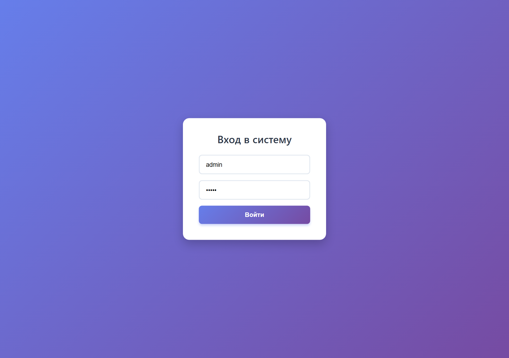
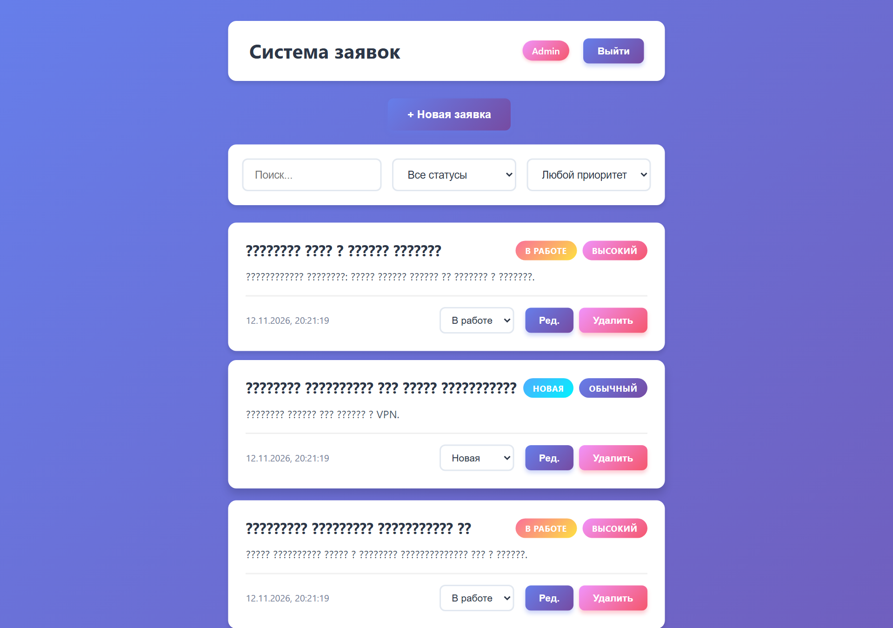

# 🎫 Ticket Management System

> Fullstack-приложение для учёта и управления внутренними заявками.


---

## О проекте

Ticket Management System — это fullstack-приложение для создания, отслеживания и управления внутренними заявками. Разработано с использованием **FastAPI** на backend и **React + TypeScript** на frontend.

### ✨ Возможности

- 🔐 Авторизация: JWT в httpOnly-куке, все запросы к заявкам — только с валидной сессией
- 👤 Роли: администратор может удалять заявки, обычный пользователь — нет
- 📝 CRUD-операции для заявок
- 🔎 Поиск по названию и описанию без учёта регистра (включая кириллицу) и фильтры по статусу и приоритету
- 📊 Сортировка на уровне API и пагинация списка
- 🎨 Градиентный UI
- ✅ Валидация данных на frontend и backend
- 🛡️ Бизнес-правила: заявку нельзя создать сразу закрытой, а закрытую — изменить или удалить

> Сортировка в интерфейсе пока не выведена: выбрать поле и порядок можно только через параметры API.

---

## 📸 Демо

Посмотреть интерфейс без запуска можно прямо сейчас — откройте [demo.html](demo.html). Это автономная страница с теми же стилями и логикой на мок-данных: вход, список, создание/правка/удаление, фильтры. Достаточно двойного клика по файлу, backend не нужен.

**Экран входа**



**Список заявок**



---

## 🛠 Стек технологий

**Backend:**

- Python 3.11+
- FastAPI
- SQLAlchemy + SQLite
- JWT (python-jose)
- Pydantic + pydantic-settings
- Uvicorn

**Frontend:**

- React
- TypeScript
- Axios
- Vite

---

## 🚀 Быстрый старт

### Предварительные требования

- Python 3.11 или выше
- Node.js 20.19+ (или 22.12+) — требование Vite 8

### Установка и запуск Backend

```bash
cd backend

# Создаем и активируем виртуальное окружение
python -m venv .venv
# Windows (PowerShell):
.venv\Scripts\Activate.ps1
# macOS / Linux:
source .venv/bin/activate

pip install -r requirements.txt

# Настраиваем секреты: копируем .env.example в .env
# Windows:
copy .env.example .env
# macOS / Linux:
cp .env.example .env

python -m app.main
```

- Backend: http://localhost:8000
- Swagger UI: http://localhost:8000/docs

Для разработки удобнее запускать с автоперезагрузкой:

```bash
uvicorn app.main:app --reload
```

`SECRET_KEY` в `.env` — обязательное поле. Сгенерировать значение:

```bash
python -c "import secrets; print(secrets.token_urlsafe(32))"
```

### Настройки backend (`backend/.env`)

| Переменная | Обязательна | По умолчанию | Назначение |
| ---------- | ----------- | ------------ | ---------- |
| `SECRET_KEY` | да | — | Ключ подписи JWT |
| `ACCESS_TOKEN_EXPIRE_MINUTES` | нет | `60` | Время жизни токена |
| `DATABASE_URL` | нет | `sqlite:///./tickets.db` | Строка подключения к БД |
| `CORS_ORIGINS` | нет | `["http://localhost:5173"]` | Разрешённые источники для фронтенда |
| `ADMIN_USERNAME` | нет | `admin` | Логин демо-администратора |
| `ADMIN_PASSWORD` | нет | `admin` | Пароль демо-администратора |
| `COOKIE_SECURE` | нет | `false` | Ставить флаг `Secure` на куку (обязательно `true` на https) |

### Установка и запуск Frontend

```bash
cd frontend
npm install
npm run dev
```

Frontend будет доступен по адресу: http://localhost:5173

Другие скрипты:

```bash
npm run lint    # ESLint
npm run build   # сборка (tsc -b + vite build)
npm run preview # предпросмотр собранной версии
```

Адрес API по умолчанию — относительный `/api`. В разработке Vite проксирует его на `http://localhost:8000` (см. [vite.config.ts](frontend/vite.config.ts)), поэтому backend должен слушать порт `8000`. Переменную `VITE_API_URL` задавайте только если backend живет на другом домене.

### 🔐 Авторизация

При первом запуске создается демо-администратор (значения берутся из `.env`):

| Поле   | Значение |
| ------ | -------- |
| Логин  | admin    |
| Пароль | admin    |

⚠️ Логин и пароль по умолчанию подходят только для локального запуска — смените их в `.env` перед выкладкой.

`POST /api/login` кладёт JWT в **httpOnly-куку** `access_token` — JavaScript её не видит, поэтому токен нельзя украсть через XSS. Браузер отправляет куку автоматически (`withCredentials: true` на фронтенде); ручной заголовок `Authorization: Bearer <token>` тоже поддерживается, например для Swagger или curl.

Выход выполняется через `POST /api/logout` — сервер удаляет куку. Удалять заявки может только пользователь с ролью администратора (`is_admin`).

На проде (https) включите `COOKIE_SECURE=true` в `.env`, иначе браузер не будет отправлять куку.

Токен живёт `ACCESS_TOKEN_EXPIRE_MINUTES` минут. Когда он истекает, фронтенд возвращает пользователя на экран входа.

### 🛡️ Бизнес-правила

- Заявку нельзя создать сразу со статусом `done` — вернётся `422`
- Заявку со статусом `done` нельзя изменить или удалить — вернётся `400`
- Удалять заявки может только администратор — обычному пользователю вернётся `403`
- Обязательные поля (`title`, `status`, `priority`) нельзя затереть, прислав `null` — вернётся `422`

### ✅ Тесты

Тесты бэкенда поднимают приложение на отдельной временной SQLite-базе, поэтому рабочая база не затрагивается:

```bash
cd backend
# Windows (PowerShell):
.venv\Scripts\python.exe -m pytest
# macOS / Linux:
.venv/bin/python -m pytest
```

Понадобятся зависимости из `requirements.txt` (`pytest`, `httpx`).

---

## 📖 API Endpoints

**Авторизация:**

- `POST /api/login` — Вход в систему, ставит httpOnly-куку и возвращает текущего пользователя
- `POST /api/logout` — Выход, удаляет куку
- `GET /api/me` — Текущий пользователь (нужен для восстановления сессии)

**Заявки (все требуют авторизацию):**

- `GET /api/tickets` — Получить список заявок
- `POST /api/tickets` — Создать заявку
- `GET /api/tickets/{id}` — Получить заявку по ID
- `PUT /api/tickets/{id}` — Обновить заявку
- `DELETE /api/tickets/{id}` — Удалить заявку (только admin)

**Параметры для `GET /api/tickets`:**

```
?page=1              # Номер страницы (по умолчанию: 1)
&page_size=10        # Размер страницы (по умолчанию: 10, максимум: 100)
&status=new          # Фильтр по статусу: new | in_progress | done
&priority=high       # Фильтр по приоритету: low | normal | high
&search=текст        # Поиск по названию и описанию без учёта регистра
&sort_by=created_at  # created_at | updated_at | title | status | priority | id
&sort_order=desc     # asc | desc
```

---

## 📊 Модель данных

**Заявка (Ticket)**

- `id` (int) — Уникальный идентификатор
- `title` (string) — Заголовок (3-120 символов)
- `description` (string, необязательно) — Описание (до 1000 символов)
- `status` (enum) — Статус: new, in_progress, done
- `priority` (enum) — Приоритет: low, normal, high
- `created_at` (datetime) — Дата создания (UTC)
- `updated_at` (datetime) — Дата последнего изменения (UTC)

**Пользователь (User)**

- `id` (int) — Уникальный идентификатор
- `username` (string) — Логин (уникальный)
- `hashed_password` (string) — Хеш пароля (bcrypt)
- `is_admin` (bool) — Признак администратора

---

## 📁 Структура проекта

```
ticket-app/
├── backend/
│   ├── app/
│   │   ├── __init__.py
│   │   ├── main.py          # Точка входа приложения, роуты
│   │   ├── config.py        # Настройки из .env
│   │   ├── database.py      # Движок БД и сессии
│   │   ├── models.py        # Модели SQLAlchemy
│   │   ├── schemas.py       # Pydantic схемы
│   │   ├── crud.py          # Операции с БД и микро-миграции схемы
│   │   └── auth.py          # Пароли, JWT, зависимости доступа
│   ├── tests/
│   │   ├── conftest.py      # Фикстуры: клиент, аноним, авторизованный
│   │   └── test_api.py      # Тесты API
│   ├── .env.example         # Шаблон настроек
│   └── requirements.txt     # Зависимости Python
│
├── frontend/
│   ├── public/
│   │   └── favicon.svg
│   ├── src/
│   │   ├── main.tsx         # Точка входа
│   │   ├── App.tsx          # Экраны входа и списка заявок
│   │   ├── api.ts           # HTTP-клиент (axios, withCredentials)
│   │   ├── types.ts         # Типы данных
│   │   ├── index.css        # Базовые стили
│   │   └── App.css          # Стили приложения
│   ├── .env.example         # Шаблон VITE_API_URL
│   ├── index.html
│   ├── vite.config.ts
│   └── package.json         # Зависимости Node
│
├── docs/
│   └── screenshots/     # Картинки для README
├── demo.html            # Автономное демо интерфейса (без backend)
├── .gitignore
└── README.md
```
